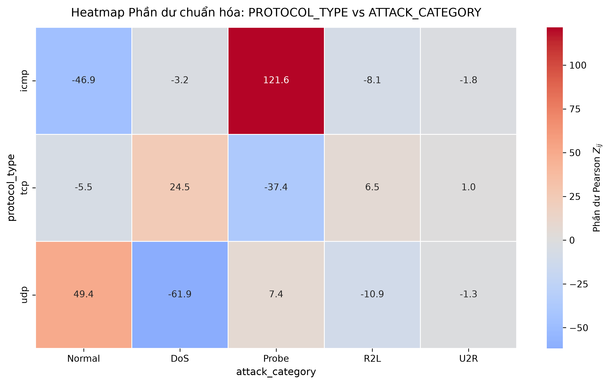

# Kiểm định Chi-square: `protocol_type` × `attack_category` (NSL-KDD)

Mã nguồn phần phân tích kiểm định độc lập Chi-square trong bài tập lớn môn Xác suất và Thống kê (MT2013), Nhóm 18, lớp L15. Thư mục này chỉ chứa phần Chi-square. Tiền xử lý dữ liệu và các phân tích khác nằm ở các phần còn lại của báo cáo.

## Mục tiêu

Kiểm định giả thuyết không $H_0$: hai biến `protocol_type` và `attack_category` độc lập trong tổng thể, với mức ý nghĩa $\alpha = 0{,}05$. Khi bác bỏ $H_0$, script đo độ mạnh của liên hệ bằng hệ số Cramér's $V$ và định vị các ô lệch nhiều nhất bằng heatmap phần dư chuẩn hóa.

## Dữ liệu

- Nguồn: tập huấn luyện NSL-KDD (`KDDTrain+.txt`), $n = 125\,973$ bản ghi.
- Đầu vào của script: `train_clean.csv`, bản đã tiền xử lý ở phần xử lý dữ liệu của báo cáo, có sẵn cột `attack_category` nhận một trong năm giá trị Normal, DoS, Probe, R2L, U2R.

## Cấu trúc thư mục

```
TASK_3_4/
├── Code/
│   ├── task34_chi_square.py   # script phân tích
│   ├── requirements.txt       # thư viện cần cài
│   ├── figures/               # heatmap xuất ra (task34_heatmap_residuals_protocol_type.png)
│   └── ket_qua/               # kết quả đầu ra của lần chạy
└── Latex/                     # mã nguồn LaTeX của báo cáo
```

## Cài đặt

Script đã chạy thành công với Python 3.14.7.

```bash
cd Code
pip install -r requirements.txt
```

## Cách chạy

Đặt `train_clean.csv` cạnh script hoặc trong `data/processed/`, rồi chạy:

```bash
python task34_chi_square.py
```

Nếu file dữ liệu nằm ở chỗ khác, truyền đường dẫn bằng `--data`; đổi nơi lưu heatmap bằng `--out`:

```bash
python task34_chi_square.py --data duong/dan/train_clean.csv --out figures/task34_heatmap_residuals_protocol_type.png
```

## Quy trình trong script

1. Đọc dữ liệu và chuẩn hóa nhãn `attack_category`.
2. Lập bảng chéo tần số quan sát bằng `pd.crosstab`.
3. Chạy `scipy.stats.chi2_contingency`, rồi kiểm tra điều kiện Cochran trên ma trận tần số kỳ vọng $E_{ij}$.
4. Tính Cramér's $V = \sqrt{\chi^2 / (n \cdot \min(r-1,\, c-1))}$.
5. Tính phần dư chuẩn hóa $Z_{ij} = (O_{ij} - E_{ij}) / \sqrt{E_{ij}}$ và vẽ heatmap.

## Kết quả

| Đại lượng | Giá trị |
|---|---|
| Số ô có $E_{ij} < 5$ | 6,7% (1/15), $E_{\min} = 3{,}42$ |
| $\chi^2$ | 25578,3820 |
| Bậc tự do | 8 |
| $p$-value | 0 (thư viện hiển thị `0.0000e+00`) |
| Cramér's $V$ | 0,3186 |

Quyết định: $p$-value nhỏ hơn $\alpha = 0{,}05$, nên bác bỏ $H_0$. `protocol_type` và `attack_category` phụ thuộc nhau, với độ mạnh liên hệ trung bình, sát ngưỡng mạnh.

Phần dư chuẩn hóa $Z_{ij}$:

| `protocol_type` | Normal | DoS | Probe | R2L | U2R |
|---|---:|---:|---:|---:|---:|
| ICMP | -46,91 | -3,20 | **121,59** | -8,09 | -1,85 |
| TCP | -5,53 | 24,55 | -37,39 | 6,46 | 1,02 |
| UDP | 49,36 | **-61,87** | 7,43 | -10,88 | -1,28 |



## Ghi chú

- Giá trị $p$-value hiển thị bằng 0 do giới hạn số học của số thực 64 bit, không phải đúng bằng 0.
- Điều kiện Cochran thỏa mãn: chỉ ô (ICMP, U2R) có $E_{ij} < 5$.
- Kết quả chỉ áp dụng cho tập NSL-KDD, không suy ra cho mạng Internet thực tế.
